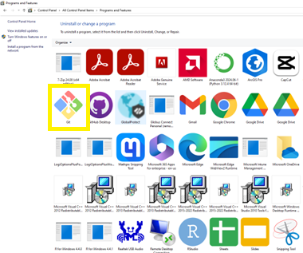
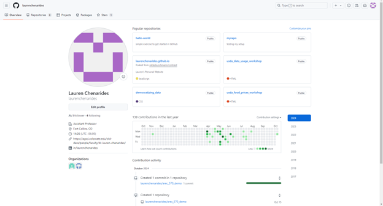
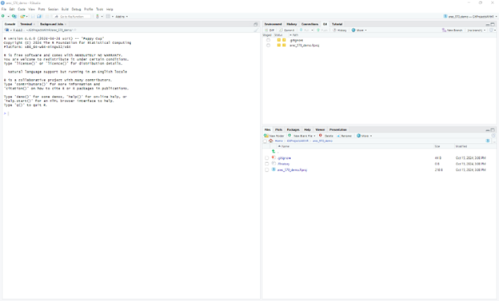
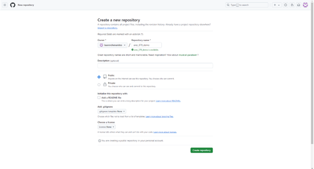
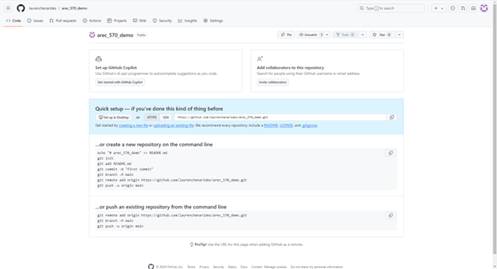
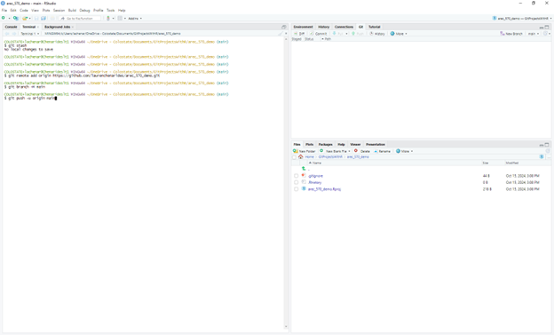
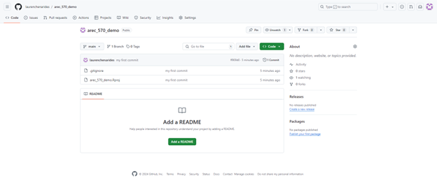
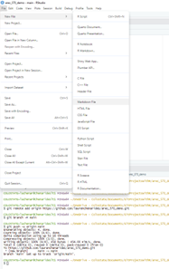
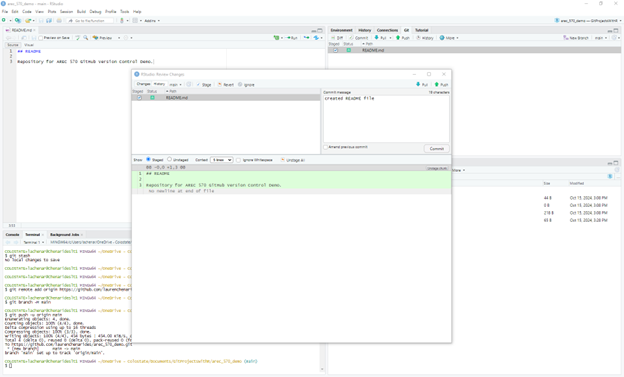
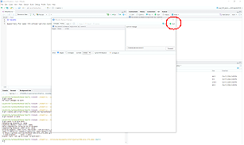

# Setting up Git and GitHub in RStudio

Complete Parts One through Three before Lecture 5.3. Part Four is for your own
research project.

## Part One: Install Git and connect RStudio to GitHub

1. Install Git: <https://github.com/git-guides/install-git>. On Windows, accept
   the installer defaults. Restart RStudio afterward.

   

2. Create a GitHub account: <https://github.com/signup>. Use an address you will
   keep after graduation, and add your university address as a second email.
   Students can request free GitHub Pro through
   [GitHub Education](https://education.github.com/).

   

3. Give Git your name and email. In the RStudio **Console**:

   ```r
   install.packages(c("usethis", "gitcreds"))
   usethis::use_git_config(
     user.name  = "Your Name",
     user.email = "the-email-on-your-github-account@example.edu"
   )
   ```

4. Create a personal access token (PAT), which RStudio uses in place of your
   GitHub password when it pushes:

   ```r
   usethis::create_github_token()   # opens GitHub; keep the default scopes
   gitcreds::gitcreds_set()         # paste the token when prompted
   ```

   Your operating system's credential manager stores the token. Anyone with
   the token can push to your repositories, so keep it private.

5. Confirm the setup. The report should list your name, email, and a token
   with no errors:

   ```r
   usethis::git_sitrep()
   ```

## Part Two: Request and store a Census API key

The Census Bureau requires a key for every API request.

1. Fill out the form at <https://api.census.gov/data/key_signup.html> with your
   organization and university email.
2. The Census Bureau emails you a 40-character key and an activation link.
   Select the link; the key works once it is activated.
3. In the RStudio Console, open your user-level environment file:

   ```r
   usethis::edit_r_environ()
   ```

4. Add one line, with your key in place of the placeholder, and save the file:

   ```text
   CENSUS_API_KEY=paste_your_key_here
   ```

5. Restart R (**Session > Restart R**) and check that R can read the key:

   ```r
   nzchar(Sys.getenv("CENSUS_API_KEY"))   # TRUE when the key is set
   ```

The file lives in your home directory, outside every project, so the key stays
on your computer. Scripts read it with `Sys.getenv("CENSUS_API_KEY")`. Keep
the key out of scripts, emails, and screenshots.

## Part Three: Get a copy of this demo project in RStudio

### Fork or template?

GitHub offers two ways to copy someone else's repository into your account.

| | Fork | Template |
|---|---|---|
| History | Keeps every commit and tag from the original | Starts a new history with one commit |
| Link to the original | Yes: you can pull later updates and propose changes back | None |
| Visibility | Public when the original is public | Your choice, public or private |
| Use it for | Following a project that keeps changing; contributing to someone else's code | Starting your own project from a standard layout |

For this course, **fork** the demo. The fork keeps the tags for each lecture,
and **Sync fork** on GitHub brings in updates during the semester. Because the
fork is public, keep your own research data and code in a separate private
repository (Part Four).

### Steps

1. Open <https://github.com/laurenchenarides/arec_570_demo> and select
   **Fork** (top right), then **Create fork**.
2. On your fork, select the green **Code** button and copy the HTTPS URL.
3. In RStudio: **File > New Project > Version Control > Git**. Paste the URL,
   choose where the folder should live, and select **Create Project**.

   Keep Git projects in a regular folder such as `C:/Users/you/GitProjects`.
   Cloud-synced folders (OneDrive, Dropbox) can lock or duplicate the files Git
   uses to track changes.

4. RStudio opens the project and shows a **Git** tab in the upper-right pane.

   

5. Run `source("run_all.R")`. To run the Lecture 5.2 version, switch to that
   stage first (see [git-in-rstudio.md](git-in-rstudio.md)).

## Part Four: Put an existing project under version control

Use this for your own research project, which already exists as a folder.

1. Open the project in RStudio. If it has no `.Rproj` file, create one with
   **File > New Project > Existing Directory**.
2. Run `usethis::use_git()` and answer the prompts to make an initial commit.
   (The menu equivalent is **Tools > Version Control > Project Setup > Git**.)
3. Before the first commit, list credentials, confidential data, and large
   files in `.gitignore`. See [git-in-rstudio.md](git-in-rstudio.md).
4. Run `usethis::use_github(private = TRUE)` to create a private GitHub
   repository and push. Keep restricted or licensed data off GitHub entirely,
   including private repositories.

The screenshots below follow the manual route, which does the same thing:

- Create an empty repository on GitHub without a README.

  

- Copy the commands under "…or push an existing repository from the command
  line."

  

- Paste them into the RStudio **Terminal** tab (next to the Console) and press
  Enter.

  

- Refresh the GitHub page. The files now appear online.

  

## Part Five: Add and push a README

1. **File > New File > Markdown File**. (Choose Markdown File; R Markdown is a
   separate format.) Save it as `README.md`.

   

2. In the Git tab, check **Staged** next to the file, select **Commit**, write a
   message, and select **Commit**.

   

3. Select **Push** (green up arrow) to send the commit to GitHub.

   

## References

- Battiston and Gars, 2021. *Git for Research in Economics*.
  <https://leap.unibocconi.eu/sites/default/files/media/attach/LEAPgit_handout.pdf>
- Bryan, J. *Happy Git and GitHub for the useR*. <https://happygitwithr.com/>
- Riffomonas Project, 2021. *Connecting an existing RStudio project to Git and
  GitHub*. <https://youtu.be/bUoN85QvC10>
- Sostero, 2018. *Git better: Collaborative project management using Git and
  GitHub*. <https://matteosostero.com/files/slides_git.pdf>
