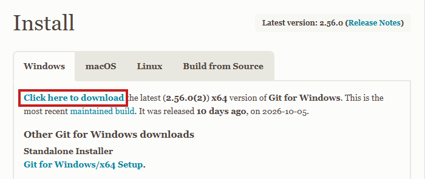
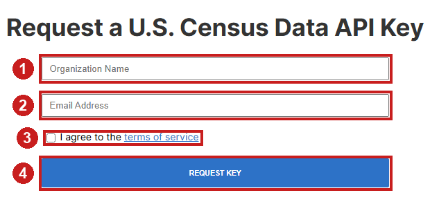
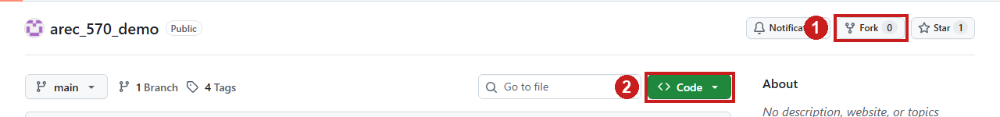

# Setting up Git and GitHub in RStudio

Complete Parts One and Two on the laptop you will bring to Lecture 5.3. Each
part ends with a checkpoint: a command to run and the result to look for. We
will complete Part Three together in class. Part Four is for your own research
project.

Budget 30 to 45 minutes. Installing Git and waiting for the Census email take
most of that time.

**Before you start:** R and RStudio are installed, and you can open RStudio.
Every command below goes in the RStudio **Console** (the pane with the `>`
prompt) unless the step says otherwise.

## Part One: Install Git and connect RStudio to GitHub

### 1. Install Git

**Windows**

1. Go to <https://git-scm.com/downloads/win> and select **Click here to
   download**.

   

2. Run the installer and accept every default setting (select **Next** on each
   screen, then **Install**).

**Mac**

1. Open the **Terminal** app (Applications > Utilities > Terminal).
2. Type `git --version` and press Return.
3. If a version number appears, Git is already installed. If macOS offers to
   install the "command line developer tools," select **Install** and wait for
   it to finish.

**Both:** quit RStudio completely and open it again, so RStudio finds Git.

**Checkpoint.** In the RStudio Console, run:

```r
system("git --version")
```

You should see a line such as `git version 2.56.0`. If you see an error
instead, see [Troubleshooting](#troubleshooting).

### 2. Create a GitHub account

1. Go to <https://github.com/signup> and follow the prompts. Choose a username
   you are comfortable sharing with coauthors and journals.
2. Use an email address you will keep after graduation. You can add your
   university address later under *Settings > Emails*.
3. Confirm your email address from the message GitHub sends.
4. GitHub may ask you to set up two-factor authentication. Follow the prompts;
   an authenticator app on your phone works well.

Students can request free GitHub Pro and other tools through
[GitHub Education](https://education.github.com/) (optional).

### 3. Install the helper packages and introduce yourself to Git

Run in the Console, with your own name and the email from your GitHub account:

```r
install.packages(c("usethis", "gitcreds"))

usethis::use_git_config(
  user.name  = "Jane Doe",
  user.email = "jane.doe@example.edu"
)
```

Git attaches this name and email to every commit you make.

### 4. Create a personal access token

GitHub uses a personal access token (PAT) in place of your password when
RStudio sends work to GitHub.

1. Run:

   ```r
   usethis::create_github_token()
   ```

   A GitHub page titled *New personal access token (classic)* opens in your
   browser. Sign in if asked.

2. In **Note**, keep the description or type `RStudio on my laptop`.
3. Set **Expiration** to a date after the end of the semester (for example,
   90 days). The scope boxes are already checked; leave them as they are.
4. Scroll to the bottom and select **Generate token**.
5. Copy the token (it starts with `ghp_`). GitHub shows it only once, so keep
   the page open until the next step is done.

### 5. Store the token on your computer

1. Run:

   ```r
   gitcreds::gitcreds_set()
   ```

2. At the prompt `? Enter password or token:`, paste the token and press
   Enter. If R reports that credentials already exist, choose the option to
   replace them.

You should see `-> Adding new credentials...` followed by `-> Done.` Your
operating system's credential manager now stores the token. Anyone with the
token can change your repositories, so keep it out of scripts and emails.

### Checkpoint for Part One

```r
usethis::git_sitrep()
```

The report is long. Check these lines; your own name, email, and username
appear in place of the examples:

```text
── Git global (user)
• Name: "Jane Doe"
• Email: "jane.doe@example.edu"
...
── GitHub user
• Default GitHub host: "https://github.com"
• Personal access token for "https://github.com": <discovered>
• GitHub user: "janedoe"
• Token scopes: "gist", "repo", "user", and "workflow"
```

Part One is complete when Name, Email, `<discovered>`, and your GitHub
username all appear. Lines such as `Vaccinated: FALSE` and the sections about
an "active usethis project" are informational. A line that starts with `✖`
needs attention; see [Troubleshooting](#troubleshooting).

## Part Two: Request and store a Census API key

The Census Bureau requires a free key for every API request.

1. Go to <https://api.census.gov/data/key_signup.html> and complete the form:
   **(1)** Colorado State University, **(2)** your university email,
   **(3)** check the terms box, and **(4)** select **Request Key**.

   

2. Open the email from the Census Bureau (check your spam folder if it has
   not arrived after 15 minutes). It contains a 40-character key and an
   activation link. **Select the activation link**; the key works only after
   activation.
3. In the RStudio Console, open your user-level environment file:

   ```r
   usethis::edit_r_environ()
   ```

   A file named `.Renviron` opens in the editor. It may be empty.

4. Add this line, with your key in place of the placeholder (no quotation
   marks, no spaces around `=`):

   ```text
   CENSUS_API_KEY=paste_your_key_here
   ```

   **Press Enter at the end of the line**, so the file ends with a blank line.
   R skips a last line that has no line break after it.

5. Save the file (**File > Save** or Ctrl+S / Cmd+S).
6. Restart R: **Session > Restart R**.

The file lives in your home directory, outside every project, so the key
stays on your computer. Scripts read it with `Sys.getenv("CENSUS_API_KEY")`.
Keep the key out of scripts, emails, and screenshots.

### Checkpoint for Part Two

```r
nzchar(Sys.getenv("CENSUS_API_KEY"))
```

You should see `[1] TRUE`.

## Ready for Lecture 5.3

Bring your laptop to class with all three checks passing:

| Check | Expected result |
|---|---|
| `system("git --version")` | `git version 2.x` |
| `usethis::git_sitrep()` | Your name, email, `<discovered>` token, and GitHub username |
| `nzchar(Sys.getenv("CENSUS_API_KEY"))` | `[1] TRUE` |

## Troubleshooting

| Problem | Fix |
|---|---|
| `system("git --version")` says Git is not recognized or not found | Quit and reopen RStudio. If the error remains, open **Tools > Global Options > Git/SVN** and set **Git executable** to `C:/Program Files/Git/bin/git.exe` (Windows) or `/usr/bin/git` (Mac), then restart RStudio. |
| `use_git_config()` fails with an error about Git | Complete step 1 and its checkpoint first. |
| `git_sitrep()` shows `Personal access token ... <unset>` | Repeat step 5 and paste the token at the prompt. If the token page is closed, create a new token (step 4). |
| `git_sitrep()` shows `✖ Token lacks recommended scopes` or `Can't retrieve registered email addresses` | Create a new token with `usethis::create_github_token()` and keep the boxes that are already checked, then repeat step 5. |
| `git_sitrep()` reports that the token is invalid, expired, or not authorized | Create a new token (step 4) and store it (step 5). |
| `nzchar(...)` returns `FALSE` | Reopen the file with `usethis::edit_r_environ()`. Confirm the line reads exactly `CENSUS_API_KEY=` followed by the key, that a blank line follows it, and that the file is saved. Then restart R. |
| The Census key returns an "invalid key" error | Select the activation link in the Census email. |

If a step still fails, note the exact error message and bring it to class.

## Part Three (in class): Copy the demo project into your account

### Fork or template?

GitHub offers two ways to copy someone else's repository into your account.

| | Fork | Template |
|---|---|---|
| History | Keeps every commit; keeps tags and branches when you uncheck **Copy the main branch only** | Starts a new history with one commit |
| Link to the original | Yes: you can pull later updates and propose changes back | None |
| Visibility | Public when the original is public | Your choice, public or private |
| Use it for | Following a project that keeps changing; contributing to someone else's code | Starting your own project from a standard layout |

For this course, **fork** the demo. The fork keeps the tags for each lecture,
and **Sync fork** on GitHub brings in updates during the semester. Because the
fork is public, keep your own research data and code in a separate private
repository (Part Four).

### Steps

1. Open <https://github.com/laurenchenarides/arec_570_demo> while signed in to
   GitHub and select **Fork** (1).

   

2. On the *Create a new fork* page, **uncheck Copy the main branch only** so
   the fork includes the tag for each lecture, then select **Create fork**.
3. GitHub opens your fork at `github.com/your-username/arec_570_demo`. Select
   the green **Code** button (2) and copy the HTTPS URL.
4. In RStudio: **File > New Project > Version Control > Git**. Paste the URL
   into **Repository URL**, choose a parent folder, and select **Create
   Project**.

   Choose a regular folder such as `C:/Users/you/GitProjects` or
   `~/GitProjects`. Cloud-synced folders (OneDrive, Dropbox, iCloud) can lock or
   duplicate the files Git uses to track changes.

5. RStudio opens the project. A **Git** tab appears in the upper-right pane,
   next to Environment and History.
6. Run `source("run_all.R")`. To run the Lecture 5.2 version, switch to that
   stage first (see [git-in-rstudio.md](git-in-rstudio.md)).

## Part Four: Put an existing project under version control

Use this for your own research project, which already exists as a folder.

1. Open the project in RStudio. If it has no `.Rproj` file, create one with
   **File > New Project > Existing Directory**.
2. Before the first commit, list credentials, confidential data, and large
   files in `.gitignore`. See [git-in-rstudio.md](git-in-rstudio.md).
3. Run `usethis::use_git()` and answer the prompts to make an initial commit.
4. Run `usethis::use_github(private = TRUE)` to create a private GitHub
   repository and push. Keep restricted or licensed data off GitHub entirely,
   including private repositories.

## References

- Battiston and Gars, 2021. *Git for Research in Economics*.
  <https://leap.unibocconi.eu/sites/default/files/media/attach/LEAPgit_handout.pdf>
- Bryan, J. *Happy Git and GitHub for the useR*. <https://happygitwithr.com/>
- Riffomonas Project, 2021. *Connecting an existing RStudio project to Git and
  GitHub*. <https://youtu.be/bUoN85QvC10>
- Sostero, 2018. *Git better: Collaborative project management using Git and
  GitHub*. <https://matteosostero.com/files/slides_git.pdf>
